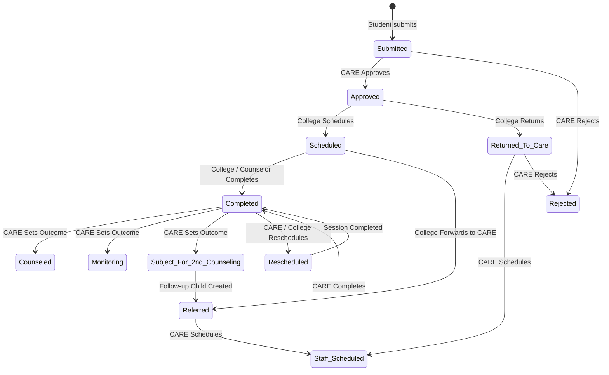

# Counseling Flow v2 Design Specification (Approval Gates + Outcome Statuses)

**Date:** 2026-09-28  
**Scope:** CARE Portal, College/Department Portal, Student Portal, Supabase DB & Edge Functions  
**Status:** Approved & Implemented

---

## 1. Architectural Decisions

| Decision Topic | Resolution | Rationale |
|---|---|---|
| **Outcomes Representation** | Statuses (not tags or labels) | Single source of truth across RLS, analytics, filters, and state machine |
| **Re-counseling Architecture** | Hybrid: In-place `Rescheduled` for single-session adjustments; linked child row (`follow_up_of`) for distinct multi-session interventions | Keeps appointment histories clean without recursive state explosion |
| **Action Trigger** | Shared interaction model: Right-click context menu, long-press (mobile/tablet), and 3-dots trigger button | Accessible on all desktop and touch devices |
| **Permissions** | New `manage_counseling_outcome` permission (assigned to Care Staff by default); standard `counseling` feature permission for scheduling | Ensures role-based governance over clinical outcomes |
| **Portal Visibility** | College: Read-only visibility into outcomes; Student: Neutral user-friendly wording ("For Follow-up Session", "Under CARE Handling") | Avoids clinical anxiety for students; prevents unauthorized college edits |

---

## 2. State Machine

### 6 New Statuses
- `Approved`: CARE staff verified the student's counseling request and assigned it to their college.
- `Returned_To_Care`: College department could not schedule/handle the session and returned it to CARE.
- `Counseled`: Completed session where concerns were resolved.
- `Monitoring`: Completed session where concerns were addressed and student is placed on monitoring.
- `Subject_For_2nd_Counseling`: Completed session designated for a subsequent counseling intervention.
- `Rescheduled`: Same session row re-dated with new appointment time.

### State Transitions

---

## 3. Database & Security

1. **Linkage Schema**:
   - `counseling_requests.follow_up_of` (`BIGINT REFERENCES public.counseling_requests(id) ON DELETE SET NULL`).
   - Filtered index `counseling_requests_follow_up_idx` ON `counseling_requests(follow_up_of) WHERE follow_up_of IS NOT NULL`.
2. **Evaluation & Feedback Eligibility**:
   - Outcome statuses (`Completed`, `Counseled`, `Monitoring`, `Subject_For_2nd_Counseling`) are recognized by:
     - `student_may_evaluate_counseling(request_id)`
     - `student_has_completed_counseling()`
     - RLS policy `counseling_requests_student_feedback_update`
     - RPC `public_counseling_evaluate()`
3. **RBAC**:
   - Permission key `manage_counseling_outcome` seeded for `Care Staff`.
